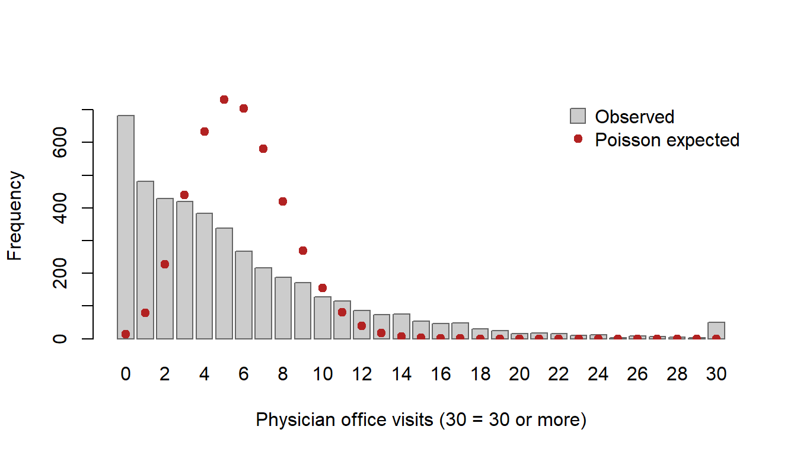

# Negative Binomial and Zero-Inflated Negative Binomial Regression by IRLS and EM

## 1 Introduction

Many responses in applied work are counts: the number of doctor visits,
of articles published, of insurance claims. The Poisson regression model
is the natural starting point, but it forces the variance to equal the
mean. Real count data are usually *overdispersed*, with a variance well
above the mean, and they often contain *more zeros* than a Poisson model
with the same mean can produce. Ignoring overdispersion gives standard
errors that are too small and tests that reject too often; ignoring
excess zeros gives a poor fit to the most common outcome.

Two standard extensions address these problems. Negative binomial (NB)
regression adds a dispersion parameter $`\theta`$ so that the variance
can exceed the mean. Zero-inflated negative binomial (ZINB) regression
goes further and treats the data as a mixture of two groups: structural
zeros, who always report zero, and an NB group, who may or may not.

This project builds the R package **nbzinbKnight**, which fits both
models without any general-purpose optimizer. NB regression is fitted by
iteratively reweighted least squares (IRLS) for the coefficients,
alternated with Newton–Raphson for $`\theta`$; ZINB regression is fitted
by an EM algorithm whose M-steps are themselves IRLS fits. The goals are
to implement these algorithms correctly, to show that they reproduce the
established functions
[`MASS::glm.nb()`](https://rdrr.io/pkg/MASS/man/glm.nb.html) and
[`pscl::zeroinfl()`](https://rdrr.io/pkg/pscl/man/zeroinfl.html), to
check by simulation that the ZINB estimates and standard errors behave
as they should, and to use the package to analyse physician visits in
the `NMES1988` data.

## 2 Methods

### 2.1 Negative binomial regression

For a count $`Y_i`$ with covariate vector $`x_i`$, the NB2 model has
``` math

P(Y_i = y) = \frac{\Gamma(y + \theta)}{\Gamma(\theta)\, y!}
\left(\frac{\theta}{\theta + \mu_i}\right)^{\theta}
\left(\frac{\mu_i}{\theta + \mu_i}\right)^{y},
\qquad \log \mu_i = \eta_i = x_i^\top \beta + o_i ,
```
where $`o_i`$ is an optional offset. Then $`E(Y_i) = \mu_i`$ and
$`\mathrm{Var}(Y_i) = \mu_i + \mu_i^2/\theta`$, so smaller $`\theta`$
means more overdispersion and $`\theta \to \infty`$ gives the Poisson
model. With prior weights $`a_i`$ (all 1 for an ordinary fit) the
log-likelihood is
``` math

\begin{aligned}
\ell(\beta, \theta) = \sum_i a_i \bigl[ &\log\Gamma(y_i + \theta) - \log\Gamma(\theta) - \log y_i! \\
&+ \theta\log\theta + y_i \log\mu_i - (\theta + y_i)\log(\theta + \mu_i)\bigr].
\end{aligned}
```

**IRLS for $`\beta`$ ($`\theta`$ fixed).** For fixed $`\theta`$ the
model is a GLM with log link and variance function
$`V(\mu) = \mu + \mu^2/\theta`$, so Fisher scoring is repeated weighted
least squares with working weights and working response
``` math

w_i = a_i \frac{(\partial\mu_i/\partial\eta_i)^2}{V(\mu_i)} = a_i\frac{\theta\mu_i}{\theta + \mu_i},
\qquad
z_i = (\eta_i - o_i) + \frac{y_i - \mu_i}{\mu_i},
\qquad
\beta^{(t+1)} = (X^\top W X)^{-1} X^\top W z .
```
The package solves the least-squares step by a QR decomposition of
$`W^{1/2}X`$, which gives the same $`\beta`$ without forming
$`X^\top W X`$. Iteration stops when no coefficient changes by more than
$`10^{-10}`$.

**Newton–Raphson for $`\theta`$ ($`\beta`$ fixed).** The score and
second derivative in $`\theta`$ are \$\$ \begin{aligned} U(\theta) &=
\sum_i a_i\Bigl\[\psi(y_i+\theta) - \psi(\theta) + \log\theta + 1 \\
&\qquad\quad - \log(\theta+\mu_i) -
\frac{y_i+\theta}{\theta+\mu_i}\Bigr\], \\ H(\theta) &= \sum_i
a_i\Bigl\[\psi'(y_i+\theta) - \psi'(\theta) + \frac{1}{\theta} \\
&\qquad\quad - \frac{2}{\theta+\mu_i} +
\frac{y_i+\theta}{(\theta+\mu_i)^2}\Bigr\], \end{aligned} \$\$ with
$`\psi`$ and $`\psi'`$ the digamma and trigamma functions. To keep
$`\theta > 0`$ the update is made on $`\phi = \log\theta`$, using
$`U_\phi = \theta U`$ and $`H_\phi = \theta^2 H + \theta U`$:
$`\phi \leftarrow \phi - U_\phi / H_\phi`$. As safeguards, a step that
would lower the log-likelihood is halved until it does not, and if
$`H_\phi \ge 0`$ (the log-likelihood is not concave at that point) a
unit step uphill is taken instead.

**Outer loop.** The fit starts from a Poisson IRLS fit (the
$`\theta\to\infty`$ limit of the weights, $`w_i = a_i\mu_i`$) and the
moment estimate
$`\theta_0 = \sum_i a_i\mu_i^2 / \sum_i a_i[(y_i-\mu_i)^2 - \mu_i]`$. It
then alternates the two updates until the log-likelihood changes by less
than $`10^{-8}`$.

**Standard errors.** Following `glm.nb()`,
$`\widehat{\mathrm{Var}}(\hat\beta)
= (X^\top \hat W X)^{-1}`$, treating $`\theta`$ as known, and
$`\mathrm{SE}(\hat\theta) = \{-H(\hat\theta)\}^{-1/2}`$.

### 2.2 Zero-inflated negative binomial regression

In the ZINB model, observation $`i`$ is a structural zero with
probability $`\pi_i`$ and otherwise comes from
$`\mathrm{NB}(\mu_i, \theta)`$:
``` math

P(Y_i = 0) = \pi_i + (1-\pi_i) f_{\mathrm{NB}}(0;\mu_i,\theta), \qquad
P(Y_i = y) = (1-\pi_i) f_{\mathrm{NB}}(y;\mu_i,\theta),\ y \ge 1,
```
with $`f_{\mathrm{NB}}(0;\mu,\theta) = \{\theta/(\theta+\mu)\}^\theta`$,
$`\log\mu_i = x_i^\top\beta + o_i`$, and
$`\mathrm{logit}\,\pi_i = z_i^\top\gamma`$, where the zero-model
covariates $`z_i`$ may differ from $`x_i`$. The marginal mean is
$`(1-\pi_i)\mu_i`$. Because each zero contributes
$`\log[\pi_i + (1-\pi_i)f_{\mathrm{NB}}(0)]`$, the log of a sum, the
log-likelihood is not that of an exponential-family GLM and cannot be
maximized by IRLS directly.

**EM algorithm.** Let $`D_i = 1`$ if observation $`i`$ is a structural
zero. If the $`D_i`$ were known, the complete-data log-likelihood would
split into a logistic regression for $`\gamma`$ and an NB regression for
$`(\beta,\theta)`$ on the non-structural observations, each of which
IRLS can fit. EM replaces the unknown $`D_i`$ by their conditional
expectations:

- *E-step:*
  $`\tau_i = P(D_i = 1 \mid y_i) = \pi_i / [\pi_i + (1-\pi_i)f_{\mathrm{NB}}(0;\mu_i,\theta)]`$
  if $`y_i = 0`$, and $`\tau_i = 0`$ if $`y_i > 0`$.
- *M-step, zero part:* maximize
  $`\sum_i[\tau_i\log\pi_i + (1-\tau_i)\log(1-\pi_i)]`$, a logistic
  regression with fractional response $`\tau_i`$, by IRLS with
  $`w_i = \pi_i(1-\pi_i)`$ and
  $`z_i = z_i^\top\gamma + (\tau_i - \pi_i)/\{\pi_i(1-\pi_i)\}`$.
- *M-step, count part:* maximize
  $`\sum_i (1-\tau_i)\log f_{\mathrm{NB}}(y_i;\mu_i,\theta)`$, which is
  exactly the NB fit above with prior weights $`a_i = 1-\tau_i`$.

EM starts from the NB fit for $`(\beta,\theta)`$ and from an IRLS
logistic regression of $`I(y_i = 0)`$ on $`z_i`$ for $`\gamma`$,
warm-starts each M-step from the previous iterate, and stops when the
observed-data log-likelihood changes by less than $`10^{-8}`$. EM can
never decrease the log-likelihood; the package records it at every
iteration and warns if it ever falls. All probabilities are computed on
the log scale (`plogis(..., log.p = TRUE)` and a log-sum-exp for the
zero term) to avoid underflow when $`\pi_i`$ is near 0 or 1.

**Standard errors.** EM does not produce an information matrix. After
convergence the package computes the Hessian of its own observed-data
log-likelihood with respect to $`(\beta, \gamma, \log\theta)`$
numerically with
[`numDeriv::hessian()`](https://rdrr.io/pkg/numDeriv/man/hessian.html)
(differentiation, not optimization), and inverts its negative. As in
`zeroinfl()`, $`\log\theta`$ is reported with its standard error;
$`\mathrm{SE}(\hat\theta) = \hat\theta\,\mathrm{SE}(\log\hat\theta)`$ by
the delta method.

## 3 The R package

The package is on GitHub and installs with

``` r
# install.packages("devtools")
devtools::install_github("knightrt-lgtm/nbzinbKnight")
```

**Design.** The estimation code is split into small internal building
blocks, each implementing one equation of the Methods section, and two
user-facing fitting functions built from them:

| File | Contents |
|:---|:---|
| `R/nb_internal.R` | NB log-likelihood; IRLS update for $`\beta`$; score and second derivative in $`\theta`$; Newton–Raphson for $`\log\theta`$ |
| `R/nbreg.R` | [`nbreg()`](https://knightrt-lgtm.github.io/nbzinbKnight/reference/nbreg.md), [`nbreg_control()`](https://knightrt-lgtm.github.io/nbzinbKnight/reference/nbreg_control.md), and the outer loop with standard errors |
| `R/zinb_internal.R` | ZINB log-likelihood; E-step; fractional logistic IRLS; numerical-Hessian covariance |
| `R/zinbreg.R` | [`zinbreg()`](https://knightrt-lgtm.github.io/nbzinbKnight/reference/zinbreg.md), [`zinbreg_control()`](https://knightrt-lgtm.github.io/nbzinbKnight/reference/zinbreg_control.md), and the EM loop |
| `R/methods-*.R` | S3 methods for both classes |

The count-part M-step of
[`zinbreg()`](https://knightrt-lgtm.github.io/nbzinbKnight/reference/zinbreg.md)
calls the same function that
[`nbreg()`](https://knightrt-lgtm.github.io/nbzinbKnight/reference/nbreg.md)
uses, with prior weights $`1 - \tau_i`$, so the NB code is written and
tested once.
[`zinbreg()`](https://knightrt-lgtm.github.io/nbzinbKnight/reference/zinbreg.md)
reads two-part formulas `y ~ x1 + x2 | z1 + z2` with the **Formula**
package; without `|`, both parts use the same covariates, as in
`zeroinfl()`. Both functions accept an offset for the count model, as an
argument or as [`offset()`](https://rdrr.io/r/stats/offset.html) in the
formula, and give informative errors for invalid responses. They warn if
the algorithm reaches its iteration limit without converging or if
$`\hat\theta`$ becomes very large (the Poisson limit). No function in
`R/` calls [`optim()`](https://rdrr.io/r/stats/optim.html),
[`glm()`](https://rdrr.io/r/stats/glm.html), or any other optimizer or
fitting function.

**Objects and methods.**
[`nbreg()`](https://knightrt-lgtm.github.io/nbzinbKnight/reference/nbreg.md)
and
[`zinbreg()`](https://knightrt-lgtm.github.io/nbzinbKnight/reference/zinbreg.md)
return S3 objects of class `"nbreg"` and `"zinbreg"`, containing the
coefficients, covariance matrix, $`\hat\theta`$ and its standard error,
the log-likelihood, the number of iterations, a convergence flag, fitted
values, and the call. Both classes have `print`, `summary` (Wald
tables), `coef`, `vcov`, `logLik` (with a `df` attribute, so
[`AIC()`](https://rdrr.io/r/stats/AIC.html) and
[`BIC()`](https://rdrr.io/r/stats/AIC.html) work), `fitted`, `residuals`
(Pearson and response), `nobs`, and `predict` methods. For ZINB fits,
[`predict()`](https://rdrr.io/r/stats/predict.html) returns the mean
$`(1-\pi)\mu`$, the count mean $`\mu`$, or the zero probability $`\pi`$
(`type = "response"`, `"count"`, `"zero"`).

**Usage.**

``` r
data("bioChemists", package = "pscl")
fit <- zinbreg(art ~ fem + mar + kid5 + phd + ment | ment, data = bioChemists)
coef(fit, model = "zero")
```

    (Intercept)        ment
     -0.8066566  -0.6094417 

``` r
AIC(fit)
```

    [1] 3124.542

``` r
predict(fit, newdata = bioChemists[1:3, ], type = "zero")
```

              1           2           3
    0.006226169 0.011392898 0.011392898 

**Testing.** The package has testthat tests that compare both functions
with `glm.nb()` and `zeroinfl()` on both data sets within the project’s
required tolerances, plus tests of offsets, single-covariate and
two-part formulas, every S3 method, the monotone EM log-likelihood, and
input errors.
[`devtools::check()`](https://devtools.r-lib.org/reference/check.html)
reports 0 errors, 0 warnings, and 0 notes, and the same check runs on
GitHub Actions for macOS, Windows, and Linux.

## 4 Benchmarking

The script `inst/benchmark/benchmark.R` fits both models on
`bioChemists` (n = 915) and `NMES1988` (n = 4406) with this package and
with the reference functions, run with tight tolerances
(`glm.control(epsilon = 1e-10)` and `zeroinfl.control(reltol = 1e-12)`).
The ZINB model uses all five `bioChemists` covariates in both parts, and
the `NMES1988` zero model uses `hospital`, `chronic`, `gender`,
`school`, and `insurance`. [Table 1](#tbl-bench-agree) gives the largest
absolute difference for each quantity against the tolerance required by
the project; the full side-by-side estimates are in the Appendix.

``` r
agree <- do.call(rbind, lapply(c("bioChemists", "NMES1988"), function(ds) {
  do.call(rbind, lapply(c(nb = "NB", zinb = "ZINB"), function(mod) {
    md <- bench[[ds]][[tolower(mod)]]$max_diff
    data.frame(`Data set` = ds, Model = mod, Quantity = md$quantity,
               `Max abs. difference` = formatC(md$max_abs_diff, format = "e",
                                               digits = 1),
               Tolerance = formatC(md$tolerance, format = "e", digits = 0),
               Pass = ifelse(md$pass, "yes", "NO"), check.names = FALSE)
  }))
}))
knitr::kable(agree, row.names = FALSE, booktabs = TRUE)
```

| Data set    | Model | Quantity        | Max abs. difference | Tolerance | Pass |
|:------------|:------|:----------------|:--------------------|:----------|:-----|
| bioChemists | NB    | Coefficients    | 1.2e-10             | 1e-05     | yes  |
| bioChemists | NB    | Standard errors | 2.0e-12             | 1e-05     | yes  |
| bioChemists | NB    | Theta           | 2.4e-11             | 1e-04     | yes  |
| bioChemists | NB    | Log-likelihood  | 2.3e-13             | 1e-04     | yes  |
| bioChemists | ZINB  | Coefficients    | 1.5e-04             | 1e-03     | yes  |
| bioChemists | ZINB  | Standard errors | 9.5e-05             | 1e-03     | yes  |
| bioChemists | ZINB  | Log(theta)      | 1.3e-05             | 1e-03     | yes  |
| bioChemists | ZINB  | Log-likelihood  | 4.2e-08             | 1e-03     | yes  |
| NMES1988    | NB    | Coefficients    | 5.6e-11             | 1e-05     | yes  |
| NMES1988    | NB    | Standard errors | 3.8e-12             | 1e-05     | yes  |
| NMES1988    | NB    | Theta           | 1.3e-10             | 1e-04     | yes  |
| NMES1988    | NB    | Log-likelihood  | 0.0e+00             | 1e-04     | yes  |
| NMES1988    | ZINB  | Coefficients    | 2.6e-05             | 1e-03     | yes  |
| NMES1988    | ZINB  | Standard errors | 1.7e-05             | 1e-03     | yes  |
| NMES1988    | ZINB  | Log(theta)      | 4.4e-06             | 1e-03     | yes  |
| NMES1988    | ZINB  | Log-likelihood  | 1.6e-08             | 1e-03     | yes  |

Table 1: Maximum absolute difference between this package and the
reference functions, with the required tolerance.

Every quantity is within its tolerance. The NB fits agree with
`glm.nb()` to about $`10^{-10}`$, essentially to rounding error, because
both programs solve the same score equations by the same algorithm. The
ZINB fits agree with `zeroinfl()` to about $`10^{-4}`$ in the
coefficients and to better than $`10^{-7}`$ in the log-likelihood. The
remaining gap in the coefficients comes from EM’s slow final
convergence: once an iteration improves the log-likelihood by less than
$`10^{-8}`$ the algorithm stops, but the likelihood is very flat near
its maximum, so the coefficients can still be about $`10^{-4}`$ from the
optimum. The standard errors differ by a similar amount, partly for the
same reason and partly because both packages compute the ZINB Hessian
numerically, by different methods.

``` r
timing <- do.call(rbind, lapply(c("bioChemists", "NMES1988"), function(ds) {
  do.call(rbind, lapply(c(nb = "NB", zinb = "ZINB"), function(mod) {
    r <- bench[[ds]][[tolower(mod)]]
    data.frame(`Data set` = ds, Model = mod,
               nbzinbKnight = r$time[["nbzinbKnight"]],
               Reference = r$time[["reference"]], Iterations = r$iter,
               check.names = FALSE)
  }))
}))
knitr::kable(timing, digits = 2, row.names = FALSE, booktabs = TRUE)
```

| Data set    | Model | nbzinbKnight | Reference | Iterations |
|:------------|:------|-------------:|----------:|-----------:|
| bioChemists | NB    |         0.02 |      0.04 |          4 |
| bioChemists | ZINB  |         1.24 |      0.15 |        111 |
| NMES1988    | NB    |         0.06 |      0.14 |          3 |
| NMES1988    | ZINB  |         3.81 |      0.75 |         53 |

Table 2: Median computation time in seconds (10 runs for NB, 3 for
ZINB), and the number of outer (NB) or EM (ZINB) iterations.

For NB regression this package is faster than `glm.nb()`, which goes
through the more general [`glm()`](https://rdrr.io/r/stats/glm.html)
machinery. For ZINB it is several times slower than `zeroinfl()`: EM
converges linearly and needs tens to about a hundred iterations, each
containing a full weighted NB fit, whereas `zeroinfl()` updates all
parameters at once with a quasi-Newton optimizer. The numerical Hessian
for the standard errors adds further time. All fits still take only a
few seconds.

## 5 Simulation study

To check that
[`zinbreg()`](https://knightrt-lgtm.github.io/nbzinbKnight/reference/zinbreg.md)
recovers known parameters and that its standard errors are correct, the
script `inst/benchmark/simulation.R` generates $`R = 200`$ data sets of
size $`n = 500`$ from a ZINB model with one covariate in each part,
``` math

\log\mu_i = 1 + 0.5\,x_i, \qquad
\mathrm{logit}\,\pi_i = -0.5 + 1\,z_i, \qquad
\theta = 2,
```
with $`x_i`$ and $`z_i`$ independent standard normal (seed
2.0261121^{7}). About 52% of the simulated responses are zero. All 200
fits converged, with a median of 40 EM iterations.

``` r
st <- sim$summary
st$parameter <- c("Count: intercept", "Count: x", "Zero: intercept",
                  "Zero: z", "log(theta)")
names(st) <- c("Parameter", "True", "Mean estimate", "Bias", "MC SD",
               "Mean SE", "Coverage")
knitr::kable(st, digits = 3, row.names = FALSE, booktabs = TRUE)
```

| Parameter        |   True | Mean estimate |   Bias | MC SD | Mean SE | Coverage |
|:-----------------|-------:|--------------:|-------:|------:|--------:|---------:|
| Count: intercept |  1.000 |         0.992 | -0.008 | 0.069 |   0.071 |    0.950 |
| Count: x         |  0.500 |         0.508 |  0.008 | 0.056 |   0.060 |    0.955 |
| Zero: intercept  | -0.500 |        -0.516 | -0.016 | 0.198 |   0.185 |    0.955 |
| Zero: z          |  1.000 |         1.019 |  0.019 | 0.177 |   0.175 |    0.955 |
| log(theta)       |  0.693 |         0.730 |  0.037 | 0.240 |   0.231 |    0.925 |

Table 3: Simulation results (R = 200, n = 500): bias, Monte Carlo SD of
the estimates, mean estimated SE, and coverage of 95% Wald intervals.

The estimates are centred on the true values: every bias is small
compared with the Monte Carlo SD. The mean estimated standard errors are
close to the Monte Carlo SDs, so the numerical-Hessian standard errors
describe the real sampling variability well. Coverage is between 0.925
and 0.955; with 200 replications, a coverage estimate has a Monte Carlo
standard error of about 0.015, so all values are consistent with the
nominal 95%. The parameter $`\log\theta`$ shows the largest bias (0.037)
and the lowest coverage. A positive bias in $`\log\theta`$ means
$`\theta`$ is slightly overestimated on average, so the overdispersion
is slightly understated. This is not surprising: $`\theta`$ is
identified only through the extra spread of the non-structural counts,
and maximum likelihood estimates of dispersion parameters are commonly
biased in moderate samples.

## 6 Data analysis: NMES1988

The `NMES1988` data (Deb and Trivedi, 1997; Zeileis, Kleiber, and
Jackman, 2008), in the **AER** package, record the number of physician
office visits (`visits`) in 1987–88 for 4,406 people aged 66 and over in
the US National Medical Expenditure Survey. The covariates are the
number of hospital stays (`hospital`), self-perceived health (`health`:
poor, average, excellent), the number of chronic conditions (`chronic`),
`gender`, years of education (`school`), and whether the person has
private insurance (`insurance`).

### 6.1 Descriptive summary

``` r
y <- NMES1988$visits
desc <- c(n = length(y), mean = mean(y), variance = var(y),
          `variance / mean` = var(y) / mean(y),
          `observed zeros` = sum(y == 0),
          `Poisson expected zeros` = length(y) * dpois(0, mean(y)))
knitr::kable(t(desc), digits = 2, booktabs = TRUE)
```

|    n | mean | variance | variance / mean | observed zeros | Poisson expected zeros |
|-----:|-----:|---------:|----------------:|---------------:|-----------------------:|
| 4406 | 5.77 |    45.69 |            7.91 |            683 |                  13.69 |

Table 4: Summary of the number of physician office visits.

``` r
tab <- table(factor(pmin(y, 30), levels = 0:30))
bp <- barplot(tab, col = "grey80", border = "grey40",
              ylim = c(0, max(tab) * 1.1),
              xlab = "Physician office visits (30 = 30 or more)",
              ylab = "Frequency")
points(bp, length(y) * dpois(0:30, mean(y)), pch = 19, col = "firebrick")
legend("topright", c("Observed", "Poisson expected"), pch = c(22, 19),
       pt.bg = c("grey80", NA), pt.cex = c(2, 1),
       col = c("grey40", "firebrick"), bty = "n")
```



Figure 1: Observed frequencies of physician office visits (bars; 30 = 30
or more) and frequencies expected under a Poisson distribution with the
same mean (points).

The counts are strongly overdispersed: the sample variance is 45.7,
about 7.9 times the mean of 5.77, whereas a Poisson distribution has
variance equal to its mean. The zeros tell the same story more
dramatically. A Poisson distribution with the observed mean would put
only about 14 people at zero visits, but 683 (15.5%) reported none.
[Figure 1](#fig-nmes-hist) also shows the opposite failure in the right
tail: the Poisson curve is concentrated between about 2 and 10 visits,
while the data have many more people with very few visits and many more
with very many. A model for these data needs extra variance, and
possibly a separate process for the zeros.

### 6.2 Model fitting

The Poisson model is fitted with
[`glm()`](https://rdrr.io/r/stats/glm.html) for reference; the NB and
ZINB models are fitted with this package. The count model uses
`hospital`, `health`, `chronic`, `gender`, `school`, and `insurance`;
the zero-inflation model uses `hospital`, `chronic`, `gender`, `school`,
and `insurance`.

``` r
f_count <- visits ~ hospital + health + chronic + gender + school + insurance
f_zinb <- visits ~ hospital + health + chronic + gender + school + insurance |
  hospital + chronic + gender + school + insurance

m_pois <- glm(f_count, family = poisson, data = NMES1988)
m_nb   <- nbreg(f_count, data = NMES1988)
m_zinb <- zinbreg(f_zinb, data = NMES1988)
```

``` r
summary(m_zinb)
```

    Call:
    zinbreg(formula = f_zinb, data = NMES1988)

    Pearson residuals:
        Min      1Q  Median      3Q     Max
    -1.1963 -0.7105 -0.2779  0.3253 17.8452

    Count model coefficients (negbin with log link):
                     Estimate Std. Error z value Pr(>|z|)
    (Intercept)      1.193716   0.056661  21.068  < 2e-16 ***
    hospital         0.201477   0.020360   9.896  < 2e-16 ***
    healthpoor       0.285133   0.045093   6.323 2.56e-10 ***
    healthexcellent -0.319336   0.060405  -5.287 1.25e-07 ***
    chronic          0.128999   0.011931  10.813  < 2e-16 ***
    gendermale      -0.080277   0.031024  -2.588  0.00967 **
    school           0.021423   0.004358   4.916 8.82e-07 ***
    insuranceyes     0.125862   0.041588   3.026  0.00247 **
    Log(theta)       0.394147   0.035035  11.250  < 2e-16 ***
    ---
    Signif. codes:  0 '***' 0.001 '**' 0.01 '*' 0.05 '.' 0.1 ' ' 1

    Zero-inflation model coefficients (binomial with logit link):
                 Estimate Std. Error z value Pr(>|z|)
    (Intercept)  -0.04689    0.26856  -0.175  0.86140
    hospital     -0.80046    0.42080  -1.902  0.05714 .
    chronic      -1.24791    0.17831  -6.999 2.59e-12 ***
    gendermale    0.64768    0.20011   3.237  0.00121 **
    school       -0.08377    0.02625  -3.191  0.00142 **
    insuranceyes -1.17561    0.22012  -5.341 9.25e-08 ***
    ---
    Signif. codes:  0 '***' 0.001 '**' 0.01 '*' 0.05 '.' 0.1 ' ' 1

    Theta: 1.483  (SE 0.05196)
    Log-likelihood: -12090.7 on 15 df   AIC: 24211.4   BIC: 24307.3
    EM iterations: 53

### 6.3 Model comparison

``` r
pi_hat <- predict(m_zinb, type = "zero")
mu_hat <- predict(m_zinb, type = "count")
exp_zero <- c(
  Poisson = sum(dpois(0, fitted(m_pois))),
  NB      = sum(dnbinom(0, size = m_nb$theta, mu = fitted(m_nb))),
  # ZINB: P(Y = 0) = pi + (1 - pi) f_NB(0; mu, theta)
  ZINB    = sum(pi_hat + (1 - pi_hat) *
                  dnbinom(0, size = m_zinb$theta, mu = mu_hat)))
fits <- list(Poisson = m_pois, NB = m_nb, ZINB = m_zinb)
cmp <- data.frame(
  Model = names(fits),
  df = sapply(fits, function(m) attr(logLik(m), "df")),
  logLik = sapply(fits, function(m) as.numeric(logLik(m))),
  AIC = sapply(fits, AIC),
  BIC = sapply(fits, BIC),
  `Expected zeros` = exp_zero,
  check.names = FALSE)
knitr::kable(cmp, digits = 1, row.names = FALSE, booktabs = TRUE)
```

| Model   |  df |   logLik |     AIC |     BIC | Expected zeros |
|:--------|----:|---------:|--------:|--------:|---------------:|
| Poisson |   8 | -17971.6 | 35959.2 | 36010.4 |           46.7 |
| NB      |   9 | -12170.6 | 24359.1 | 24416.6 |          608.0 |
| ZINB    |  15 | -12090.7 | 24211.4 | 24307.3 |          708.9 |

Table 5: Model comparison for NMES1988 (observed zeros = 683).

The Poisson model is far behind both alternatives. Its log-likelihood is
5801 lower than the NB model’s, at the cost of a single extra parameter
($`\theta`$), and it predicts only 47 zeros against 683 observed.

Allowing overdispersion fixes most, but not all, of the problem. The NB
model predicts 608 zeros, still 75 short of the observed count. Unlike
in the `bioChemists` example, overdispersion alone does not account for
the zeros here.

The ZINB model predicts 709 zeros, closer to the observed 683 (it
slightly overshoots), and raises the log-likelihood by a further 79.8
with 6 extra parameters. Both information criteria prefer it: AIC is
147.7 lower than for the NB model and BIC, which penalizes the extra
parameters more heavily, is still 109.3 lower. We do not use a
likelihood-ratio test of NB against ZINB: the NB model corresponds to
$`\pi = 0`$, which lies on the boundary of the ZINB parameter space
($`\gamma \to -\infty`$), so the usual $`\chi^2`$ reference distribution
does not apply.

### 6.4 Interpretation

``` r
# Exponentiated estimate with 95% Wald interval: exp(est +/- 1.96 SE)
wald_ci <- function(tab) {
  est <- tab[, "Estimate"]
  se <- tab[, "Std. Error"]
  sprintf("%.2f (%.2f, %.2f)", exp(est), exp(est - 1.96 * se),
          exp(est + 1.96 * se))
}
s_nb <- summary(m_nb)$coefficients[-1, ]
s_zc <- summary(m_zinb)$coefficients$count
s_zc <- s_zc[!(rownames(s_zc) %in% c("(Intercept)", "Log(theta)")), ]
s_zz <- summary(m_zinb)$coefficients$zero[-1, ]
# Readable covariate labels for the tables
nice <- function(x) {
  lab <- c(hospital = "Hospital stays", healthpoor = "Health: poor (vs average)",
           healthexcellent = "Health: excellent (vs average)",
           chronic = "Chronic conditions", gendermale = "Male (vs female)",
           school = "Years of education", insuranceyes = "Private insurance")
  unname(ifelse(x %in% names(lab), lab[x], x))
}
```

``` r
knitr::kable(data.frame(Covariate = nice(rownames(s_nb)),
                        `NB IRR (95% CI)` = wald_ci(s_nb),
                        `ZINB count IRR (95% CI)` = wald_ci(s_zc),
                        check.names = FALSE),
             row.names = FALSE, booktabs = TRUE, align = "lcc")
```

| Covariate                      |  NB IRR (95% CI)  | ZINB count IRR (95% CI) |
|:-------------------------------|:-----------------:|:-----------------------:|
| Hospital stays                 | 1.24 (1.20, 1.29) |    1.22 (1.18, 1.27)    |
| Health: poor (vs average)      | 1.36 (1.23, 1.49) |    1.33 (1.22, 1.45)    |
| Health: excellent (vs average) | 0.71 (0.63, 0.80) |    0.73 (0.65, 0.82)    |
| Chronic conditions             | 1.19 (1.16, 1.22) |    1.14 (1.11, 1.16)    |
| Male (vs female)               | 0.88 (0.83, 0.94) |    0.92 (0.87, 0.98)    |
| Years of education             | 1.03 (1.02, 1.04) |    1.02 (1.01, 1.03)    |
| Private insurance              | 1.25 (1.16, 1.35) |    1.13 (1.05, 1.23)    |

Table 6: Count part: incidence rate ratios (IRR) with 95% Wald
confidence intervals.

``` r
knitr::kable(data.frame(Covariate = nice(rownames(s_zz)),
                        `OR (95% CI)` = wald_ci(s_zz),
                        `p-value` = format.pval(s_zz[, "Pr(>|z|)"], digits = 2),
                        check.names = FALSE),
             row.names = FALSE, booktabs = TRUE, align = "lcc")
```

| Covariate          |    OR (95% CI)    | p-value |
|:-------------------|:-----------------:|:-------:|
| Hospital stays     | 0.45 (0.20, 1.02) | 0.0571  |
| Chronic conditions | 0.29 (0.20, 0.41) | 2.6e-12 |
| Male (vs female)   | 1.91 (1.29, 2.83) | 0.0012  |
| Years of education | 0.92 (0.87, 0.97) | 0.0014  |
| Private insurance  | 0.31 (0.20, 0.48) | 9.3e-08 |

Table 7: ZINB zero part: odds ratios (OR) of being a structural zero,
with 95% Wald confidence intervals.

**Dispersion.** The NB model estimates $`\hat\theta`$ = 1.21 (SE 0.034).
At the average fitted mean of 5.9 visits, the NB variance
$`\mu + \mu^2/\theta`$ is about 34.6, compared with 5.9 under a Poisson
model. In the ZINB model, $`\hat\theta`$ = 1.48 (SE 0.052) is larger,
meaning less overdispersion among the people who do see a physician:
some of the extra variation the NB model attributes to $`\theta`$ is
explained by the separate group of structural zeros.

**Count part ([Table 6](#tbl-nmes-irr)).** The ZINB count part describes
how many visits a person makes, among people who are “at risk” of
visiting a physician. Holding the other covariates fixed:

- Each additional hospital stay multiplies the expected number of visits
  by 1.22 (about 22% more), and each additional chronic condition by
  1.14 (14% more).
- Compared with people who rate their health as average, those in poor
  health make about 33% more visits and those in excellent health about
  27% fewer.
- Men make about 8% fewer visits than women, each extra year of
  education adds about 2%, and private insurance adds about 13%.

All of these intervals exclude 1, and the NB model gives the same
directions with similar sizes. The clearest difference is insurance: the
NB IRR (1.25) is noticeably larger than the ZINB count IRR (1.13). The
ZINB model suggests that much of the insurance effect works through
*whether* a person sees a physician at all, not through how often.

**Zero part ([Table 7](#tbl-nmes-or)).** The zero part models the odds
of being a structural zero: a non-user of physician care in this period,
as opposed to a user who happened to make no visits (an NB zero).
Holding the other covariates fixed:

- Each chronic condition multiplies these odds by 0.29, a 71% reduction:
  people with chronic illness are much less likely to be non-users.
- Private insurance multiplies the odds by 0.31 (69% lower), consistent
  with cost being a barrier to any use of care.
- Men have 1.91 times the odds of women of being a non-user, and each
  extra year of education lowers the odds by about 8%.
- The hospital-stay effect points the same way (OR 0.45) but is not
  significant at the 5% level (p = 0.057), and its interval is wide.

Chronic conditions and insurance therefore act on both parts of the
model: they make a person more likely to use care at all and, among
users, to use more of it.

### 6.5 Which model?

We prefer the ZINB model for NMES1988. Unlike the `bioChemists` example,
the NB model clearly under-predicts the zeros here, both AIC and BIC
favour ZINB by a wide margin, and the zero part has several precisely
estimated effects with a sensible interpretation: illness and insurance
separate people who use physician care from those who do not. The NB
model remains a reasonable simpler summary of the count effects, whose
directions it reproduces, but it blends the decision to see a physician
with the frequency of visits, which the insurance coefficient shows can
be misleading.

## 7 Discussion

The package meets its main goal: IRLS with Newton–Raphson reproduces
`glm.nb()` essentially exactly, EM with IRLS M-steps reproduces
`zeroinfl()` within the required tolerance, and the simulation shows
that the ZINB estimates and standard errors behave as large-sample
theory predicts. Building the ZINB fit from the NB code also made the
structure of the model clear: each EM iteration is just a logistic
regression and a weighted NB regression.

The approach has limitations. EM converges linearly, so ZINB fits are
slower than `zeroinfl()` and stop slightly short of the exact maximum:
the coefficients agree to about $`10^{-4}`$ rather than to rounding
error. The ZINB standard errors depend on a numerical Hessian, and the
NB standard errors for $`\beta`$ treat $`\theta`$ as known, which
ignores its estimation uncertainty (as `glm.nb()` also does). The
package supports only the log link for the count part and the logit link
for the zero part, an offset only in the count part, and no
user-supplied observation weights. Finally, because the NB model sits on
the boundary of the ZINB parameter space, the comparison between them
relies on information criteria rather than a standard likelihood-ratio
test.

Several extensions would be natural. An analytic Hessian of the ZINB
log-likelihood would give exact standard errors and remove the
dependence on `numDeriv`. EM could be accelerated (for example with
SQUAREM), or followed by a few Newton steps on the full parameter vector
once it is close to the maximum. The same EM structure would also fit
zero-inflated Poisson models and, with small changes, hurdle models, in
which zeros and positive counts come from separate processes.

## 8 AI-use statement

## 9 References

- Cameron, A. C. and Trivedi, P. K. (2013). *Regression Analysis of
  Count Data* (2nd ed.). Cambridge University Press.
- Deb, P. and Trivedi, P. K. (1997). Demand for medical care by the
  elderly: A finite mixture approach. *Journal of Applied Econometrics*,
  12(3), 313–336.
- Dempster, A. P., Laird, N. M. and Rubin, D. B. (1977). Maximum
  likelihood from incomplete data via the EM algorithm. *JRSS-B*, 39(1),
  1–38.
- Lambert, D. (1992). Zero-inflated Poisson regression, with an
  application to defects in manufacturing. *Technometrics*, 34(1), 1–14.
- McCullagh, P. and Nelder, J. A. (1989). *Generalized Linear Models*
  (2nd ed.). Chapman & Hall.
- Venables, W. N. and Ripley, B. D. (2002). *Modern Applied Statistics
  with S* (4th ed.). Springer.
- Wickham, H. and Bryan, J. (2023). *R Packages* (2nd ed.). O’Reilly.
- Zeileis, A., Kleiber, C. and Jackman, S. (2008). Regression models for
  count data in R. *Journal of Statistical Software*, 27(8), 1–25.

## Appendix: side-by-side benchmark estimates

| Quantity        | Term        | nbzinbKnight | Reference    | Abs. difference |
|:----------------|:------------|:-------------|:-------------|:----------------|
| Coefficients    | (Intercept) | 0.256144     | 0.256144     | 1.2e-10         |
| Coefficients    | femWomen    | -0.216418    | -0.216418    | 2.1e-11         |
| Coefficients    | marMarried  | 0.150489     | 0.150489     | 5.4e-12         |
| Coefficients    | kid5        | -0.176415    | -0.176415    | 1.5e-11         |
| Coefficients    | phd         | 0.015271     | 0.015271     | 1.1e-11         |
| Coefficients    | ment        | 0.029082     | 0.029082     | 7.3e-12         |
| Standard errors | (Intercept) | 0.137348     | 0.137348     | 2.0e-12         |
| Standard errors | femWomen    | 0.072636     | 0.072636     | 7.3e-13         |
| Standard errors | marMarried  | 0.082097     | 0.082097     | 9.7e-13         |
| Standard errors | kid5        | 0.052813     | 0.052813     | 4.2e-13         |
| Standard errors | phd         | 0.035873     | 0.035873     | 4.0e-13         |
| Standard errors | ment        | 0.003214     | 0.003214     | 6.6e-14         |
| Theta           | theta       | 2.264388     | 2.264388     | 2.4e-11         |
| Theta SE        | SE(theta)   | 0.271176     | 0.271175     | 1.1e-06         |
| Log-likelihood  | logLik      | -1560.958338 | -1560.958338 | 2.3e-13         |

bioChemists, NB: this package vs glm.nb().

| Quantity        | Term               | nbzinbKnight | Reference    | Abs. difference |
|:----------------|:-------------------|:-------------|:-------------|:----------------|
| Coefficients    | count\_(Intercept) | 0.416749     | 0.416747     | 2.3e-06         |
| Coefficients    | count_femWomen     | -0.195505    | -0.195507    | 2.3e-06         |
| Coefficients    | count_marMarried   | 0.097584     | 0.097583     | 1.3e-06         |
| Coefficients    | count_kid5         | -0.151731    | -0.151732    | 1.7e-06         |
| Coefficients    | count_phd          | -0.000699    | -0.000700    | 6.4e-07         |
| Coefficients    | count_ment         | 0.024786     | 0.024786     | 3.1e-07         |
| Coefficients    | zero\_(Intercept)  | -0.191839    | -0.191688    | 1.5e-04         |
| Coefficients    | zero_femWomen      | 0.635945     | 0.635933     | 1.2e-05         |
| Coefficients    | zero_marMarried    | -1.499317    | -1.499468    | 1.5e-04         |
| Coefficients    | zero_kid5          | 0.628406     | 0.628427     | 2.1e-05         |
| Coefficients    | zero_phd           | -0.037682    | -0.037715    | 3.3e-05         |
| Coefficients    | zero_ment          | -0.882218    | -0.882293    | 7.6e-05         |
| Standard errors | count\_(Intercept) | 0.143596     | 0.143597     | 6.1e-07         |
| Standard errors | count_femWomen     | 0.075592     | 0.075593     | 1.2e-07         |
| Standard errors | count_marMarried   | 0.084452     | 0.084452     | 2.2e-08         |
| Standard errors | count_kid5         | 0.054206     | 0.054206     | 1.4e-08         |
| Standard errors | count_phd          | 0.036269     | 0.036270     | 1.8e-07         |
| Standard errors | count_ment         | 0.003492     | 0.003493     | 2.6e-07         |
| Standard errors | zero\_(Intercept)  | 1.322724     | 1.322819     | 9.5e-05         |
| Standard errors | zero_femWomen      | 0.848851     | 0.848918     | 6.6e-05         |
| Standard errors | zero_marMarried    | 0.938588     | 0.938671     | 8.2e-05         |
| Standard errors | zero_kid5          | 0.442758     | 0.442783     | 2.4e-05         |
| Standard errors | zero_phd           | 0.307987     | 0.308008     | 2.1e-05         |
| Standard errors | zero_ment          | 0.316192     | 0.316228     | 3.6e-05         |
| Log(theta)      | Log(theta)         | 0.976369     | 0.976357     | 1.3e-05         |
| Log(theta) SE   | SE(Log(theta))     | 0.135469     | 0.135469     | 4.3e-07         |
| Log-likelihood  | logLik             | -1549.990887 | -1549.990887 | 4.2e-08         |

bioChemists, ZINB: this package vs zeroinfl().

| Quantity        | Term            | nbzinbKnight  | Reference     | Abs. difference |
|:----------------|:----------------|:--------------|:--------------|:----------------|
| Coefficients    | (Intercept)     | 0.929257      | 0.929257      | 5.6e-11         |
| Coefficients    | hospital        | 0.217772      | 0.217772      | 4.2e-11         |
| Coefficients    | healthpoor      | 0.305013      | 0.305013      | 2.6e-11         |
| Coefficients    | healthexcellent | -0.341807     | -0.341807     | 3.1e-11         |
| Coefficients    | chronic         | 0.174916      | 0.174916      | 1.2e-11         |
| Coefficients    | gendermale      | -0.126488     | -0.126488     | 1.3e-12         |
| Coefficients    | school          | 0.026815      | 0.026815      | 1.1e-12         |
| Coefficients    | insuranceyes    | 0.224402      | 0.224402      | 3.4e-11         |
| Standard errors | (Intercept)     | 0.054591      | 0.054591      | 3.6e-12         |
| Standard errors | hospital        | 0.020176      | 0.020176      | 6.2e-13         |
| Standard errors | healthpoor      | 0.048511      | 0.048511      | 2.5e-12         |
| Standard errors | healthexcellent | 0.060924      | 0.060924      | 3.8e-12         |
| Standard errors | chronic         | 0.012092      | 0.012092      | 7.4e-13         |
| Standard errors | gendermale      | 0.031216      | 0.031216      | 2.1e-12         |
| Standard errors | school          | 0.004394      | 0.004394      | 2.9e-13         |
| Standard errors | insuranceyes    | 0.039464      | 0.039464      | 2.5e-12         |
| Theta           | theta           | 1.206604      | 1.206604      | 1.3e-10         |
| Theta SE        | SE(theta)       | 0.033555      | 0.033555      | 4.2e-07         |
| Log-likelihood  | logLik          | -12170.553598 | -12170.553598 | 0.0e+00         |

NMES1988, NB: this package vs glm.nb().

| Quantity | Term | nbzinbKnight | Reference | Abs. difference |
|:---|:---|:---|:---|:---|
| Coefficients | count\_(Intercept) | 1.193716 | 1.193713 | 3.2e-06 |
| Coefficients | count_hospital | 0.201477 | 0.201477 | 3.0e-08 |
| Coefficients | count_healthpoor | 0.285133 | 0.285133 | 6.2e-08 |
| Coefficients | count_healthexcellent | -0.319336 | -0.319336 | 6.4e-09 |
| Coefficients | count_chronic | 0.128999 | 0.129000 | 4.5e-07 |
| Coefficients | count_gendermale | -0.080277 | -0.080277 | 5.9e-07 |
| Coefficients | count_school | 0.021423 | 0.021423 | 3.7e-09 |
| Coefficients | count_insuranceyes | 0.125862 | 0.125864 | 1.6e-06 |
| Coefficients | zero\_(Intercept) | -0.046888 | -0.046879 | 9.0e-06 |
| Coefficients | zero_hospital | -0.800458 | -0.800483 | 2.6e-05 |
| Coefficients | zero_chronic | -1.247912 | -1.247938 | 2.6e-05 |
| Coefficients | zero_gendermale | 0.647676 | 0.647678 | 2.5e-06 |
| Coefficients | zero_school | -0.083769 | -0.083771 | 1.4e-06 |
| Coefficients | zero_insuranceyes | -1.175611 | -1.175615 | 4.7e-06 |
| Standard errors | count\_(Intercept) | 0.056661 | 0.056661 | 6.6e-08 |
| Standard errors | count_hospital | 0.020360 | 0.020360 | 1.2e-08 |
| Standard errors | count_healthpoor | 0.045093 | 0.045093 | 4.2e-08 |
| Standard errors | count_healthexcellent | 0.060405 | 0.060405 | 4.0e-08 |
| Standard errors | count_chronic | 0.011931 | 0.011931 | 1.2e-08 |
| Standard errors | count_gendermale | 0.031024 | 0.031024 | 4.1e-08 |
| Standard errors | count_school | 0.004358 | 0.004358 | 1.7e-08 |
| Standard errors | count_insuranceyes | 0.041588 | 0.041588 | 5.0e-08 |
| Standard errors | zero\_(Intercept) | 0.268559 | 0.268558 | 6.2e-07 |
| Standard errors | zero_hospital | 0.420799 | 0.420816 | 1.7e-05 |
| Standard errors | zero_chronic | 0.178310 | 0.178316 | 6.0e-06 |
| Standard errors | zero_gendermale | 0.200112 | 0.200115 | 3.0e-06 |
| Standard errors | zero_school | 0.026253 | 0.026253 | 4.3e-07 |
| Standard errors | zero_insuranceyes | 0.220116 | 0.220121 | 4.5e-06 |
| Log(theta) | Log(theta) | 0.394147 | 0.394143 | 4.4e-06 |
| Log(theta) SE | SE(Log(theta)) | 0.035035 | 0.035035 | 4.0e-08 |
| Log-likelihood | logLik | -12090.722012 | -12090.722012 | 1.6e-08 |

NMES1988, ZINB: this package vs zeroinfl().
